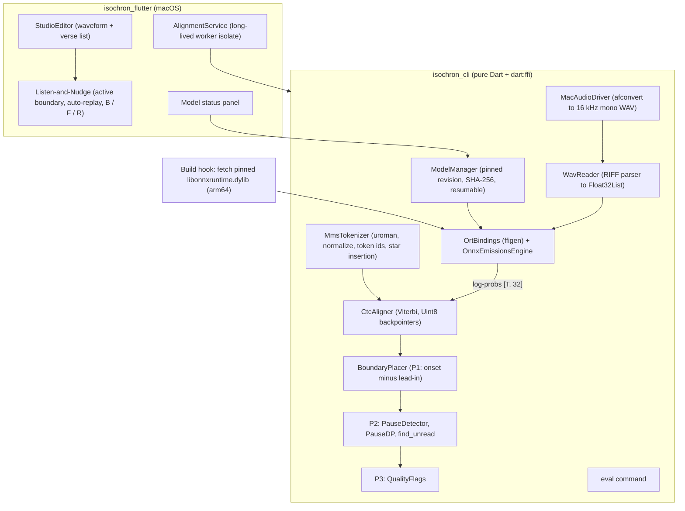

# Architecture & Implementation Plan: MMS Forced Alignment & Studio Modernization

> [!NOTE]
> **Revision 2 (2026-10-15).** Rewritten after a design review. The original draft's P2/P3 heuristics (PauseDP, `find_unread`, quality flags, and their constants) were written by an agent and are **unverified**. They're kept below as *candidate* specs. They must pass a research step (§ Phase 2.0) and an eval gate before shipping.

## Goal

Make **Isochron** a high-precision forced-alignment studio for macOS (Apple Silicon), built in Dart and Flutter, with no Python needed by developers or users:

1. **Acoustic model.** Meta MMS-300M forced aligner as ONNX (`onnx-community/mms-300m-1130-forced-aligner-ONNX`). It runs through a project-owned `dart:ffi` binding to the ONNX Runtime C API.
2. **Universal tokenization.** `package:uroman` romanizes any script into the model's 31-token Latin vocabulary.
3. **Pure-Dart algorithms.** WAV parsing, emissions windowing, CTC Viterbi alignment with `*` wildcard tokens, and (later, eval-gated) pause snapping and quality heuristics.
4. **Measured, not assumed.** Every stage is scored against human-verified ground truth with an `eval` command. Each stage ships only if it beats the previous one.
5. **Cleanup, after MMS proves itself.** Remove the legacy TTS/MFCC/DTW engine, pins, team collaboration, and the transliteration dictionary.
6. **Modernized review.** "Listen-and-Nudge" loop, active-boundary editing, ghost markers, and status/flag badges.
7. **Branch.** All work happens on `mms-aligner`.

---

## Key Facts (verified)

| Item | Value |
| :-- | :-- |
| Model repo | `onnx-community/mms-300m-1130-forced-aligner-ONNX` (from `MahmoudAshraf/mms-300m-1130-forced-aligner`, `Wav2Vec2ForCTC`) |
| Default file | `onnx/model_int8.onnx`, **317,341,664 bytes** (dynamic int8 quantization) |
| Other variants | `model.onnx` fp32 1.26 GB · `model_fp16.onnx` 632 MB · `model_q4.onnx` 241 MB |
| Input | 16 kHz mono float32. `do_normalize: true` → **per-window zero-mean / unit-variance** |
| Frame rate | Conv stride product = 320 samples → **20 ms per emission frame** (50 fps) |
| Vocab (31) | `<blank>`0 `<pad>`1 `</s>`2 `<unk>`3 a4 i5 e6 n7 o8 u9 t10 s11 r12 m13 k14 l15 d16 g17 h18 y19 b20 p21 w22 c23 v24 j25 z26 f27 `'`28 q29 x30 |
| Wildcard | Appended column **31** = `*` with a tunable constant log-prob (default 0.0) |
| uroman API | `Uroman().romanizeString(text, lcode: 'ell')` (ISO 639-3). `RomFormat.edges` gives UTF-16 offsets |
| `package:onnxruntime` | Flutter plugin only (depends on `flutter`). **Not usable** from pure-Dart `isochron_cli`, so it's not used |
| CoreML EP + int8 | `MatMulInteger`/`DynamicQuantizeLinear` aren't supported by CoreML, so they fall back to CPU. CoreML is only worth benchmarking with fp16/fp32 |
| Trellis size | 10-min chapter ≈ 30k frames × (2L+1 ≈ 12k) states ≈ 360M cells → ~360 MB of Uint8 backpointers, ~1–2 s in Dart |

---

## Phasing Overview

```mermaid
flowchart LR
    GT["Phase 0: Ground-truth fixtures (on main, current app)"] --> B["Branch mms-aligner"]
    B --> P1a["P1a: ORT FFI + build hook + ModelManager"]
    P1a --> P1b["P1b: WAV parser, emissions, tokenizer, CTC Viterbi"]
    P1b --> EV["P1c: eval CLI, MMS vs DTW, parameter sweeps"]
    EV --> GATE{"MMS beats DTW?"}
    GATE -- yes --> DEL["P1d: Delete legacy engine, pins, claims, dictionary"]
    GATE -- no --> P1b
    DEL --> UI["P1e: Worker isolate, model panel, settings, Listen-and-Nudge, JSON fields"]
    UI --> RS["P2.0: Research pass on P2/P3 specs"]
    RS --> P2["P2: Pause snapping, PauseDP, find_unread (each eval-gated)"]
    P2 --> P3["P3: Quality flags, confidence, Keep-my-edits"]
```



---

## System Architecture (target)



---

## Phase 0: Ground-Truth Fixtures (on `main`, before branching)

- Use the **current app** (DTW + manual correction) to hand-verify at least 2–3 chapters, ideally in different scripts and recording styles. Include at least one chapter with an **unscripted heading/intro** and one with a **skipped verse**.
- Store them **outside git**, e.g. `~/Dev/ethnosdev/isochron_fixtures/<name>/`:
  - `audio.<ext>`, `text.txt`, `truth.json` (existing alignment JSON format)
  - `manifest.json`: `{ "languageCode": "ell", "hasIds": true, "notes": ["has_heading", "skipped_verse"] }`

---

## Phase 1: Core MMS Engine (additive, legacy engine untouched)

### P1a: ONNX Runtime binding & model management

#### [NEW] `isochron_cli/hook/build.dart`
- Native-assets build hook. Downloads Microsoft's official `onnxruntime-osx-arm64-<pinned ver>.tgz` from GitHub releases, verifies its **SHA-256**, and emits `libonnxruntime.dylib` as a code asset.
- Flutter bundles it into `Frameworks/`, so it gets signed and notarized by the existing DMG workflow. `dart run` / `dart test` pick it up too.
- **arm64 only** (no Intel support).

#### [NEW] `isochron_cli/lib/src/ort/ort_bindings.dart` (ffigen-generated) and `ort_session.dart`
- Thin wrapper over `onnxruntime_c_api.h`: env, session options (intra-op threads = performance-core count, optional CoreML EP), session from file path, run, tensor create/read, release.
- `ffigen.yaml` checked in. Generated bindings committed.

#### [NEW] `isochron_cli/lib/src/mms/model_manager.dart`
- Cache dir: `~/Library/Application Support/isochron/models/` (the sandbox is off, so the CLI and app share it).
- Variants: `int8` (default), `fp16`, `fp32`. Each one has: file path, **pinned HF commit revision** URL (`/resolve/<sha>/onnx/...`, never `main`), expected byte size, expected **SHA-256** (the LFS oid from the HF API).
- Downloads to `<file>.part`, resumes with HTTP `Range`, verifies SHA-256, then renames atomically.
- States: `notDownloaded`, `downloading(progress)`, `verifying`, `ready`, `corrupt`. Supports cancel and delete.
- `--model-path` / an explicit path override skips management.

### P1b: Signal, tokenization, emissions, alignment

#### [MODIFY] `isochron_cli/lib/src/platform/mac_drivers.dart`
- **Keep** `MacAudioDriver` (`/usr/bin/afconvert` → `LEI16@16000`, mono). **Remove** `MacTtsDriver` (once P1d is reached).

#### [NEW] `isochron_cli/lib/src/audio/wav_reader.dart`
- Real RIFF chunk parser (walks chunks to `fmt ` / `data`, no 44-byte assumption). Validates 16 kHz / mono / PCM16 and returns a `Float32List` in [-1, 1].
- `WavUtils.getDuration` is reimplemented on top of it.

#### [NEW] `isochron_cli/lib/src/mms/mms_tokenizer.dart`
- `Uroman().romanizeString(verseText, lcode: languageCode)` for each verse. Use `RomFormat.edges` to keep a romanized-char → source-UTF-16 offset map.
- Post-uroman normalization: lowercase → NFKD → strip combining marks → keep `a–z` and `'`. Any other char becomes a word separator. **Digits are dropped** and reported as a warning on the fragment.
- Builds the token sequence over 31 ids. Inserts `*` (id 31) according to `StarPlacement`:
  - `segment` (default): before verse 1, between every pair of verses, after the last verse.
  - `edges`: only at track start and end.
- Keeps verse → token-range mapping (and in-memory char/word mapping for later word timings).
- Verses with no alignable tokens get `-1` timing + an `empty_text` warning.

#### [NEW] `isochron_cli/lib/src/mms/onnx_emissions_engine.dart`
- Windows: **30 s** chunks with **2 s context** on each side. Context frames are trimmed when stitching (20 ms frame grid).
- Each window: **zero-mean / unit-variance normalization**, run the model, then **log-softmax** over 31 classes.
- Appends column 31 = `starScore` (tunable, default `0.0`). Output: `Float32List` `[T, 32]`.
- Cooperative cancellation is checked between windows, and progress is reported per window.
- *(Dual 30 s / 10 s averaging is deferred to P2 as an eval-gated experiment.)*

#### [NEW] `isochron_cli/lib/src/mms/ctc_aligner.dart`
- Standard CTC Viterbi over the blank-interleaved sequence (2L+1 states). Transitions: stay, +1, and +2 when skipping a blank between different tokens.
- Two Float32 score rows, plus a `Uint8List` backpointer matrix `T × S`. A guard throws a clear error if `T × S` exceeds a configurable cap (default ≈ 1.5 G cells).
- Output: per-token frame spans `[f0, f1]` and mean log-prob for each token, and per-verse first/last token frames.

#### [NEW] `isochron_cli/lib/src/mms/boundary_placer.dart` (P1 rule)
- `verseStart = firstCharOnsetFrame × 0.02 s − leadIn`, where `leadIn` is a global parameter. Initial value is 0.17 s; it gets calibrated on the fixtures.
- Clamped to be ≥ the previous verse's last-char offset and ≥ 0.
- Contiguous tiling: `end(N) = start(N+1)`, and the last end = track duration.

#### [NEW] `isochron_cli/lib/src/mms/mms_pipeline.dart`
- Orchestrates decode → WAV → tokenizer → emissions → CTC → boundaries. Returns `List<Fragment>` + diagnostics (timings per stage, warnings).
- `IsochronProcessor` gains an engine switch (`dtw` | `mms`) so both coexist until P1d.

### P1c: Evaluation harness

#### [MODIFY] `isochron_cli/bin/isochron_cli.dart`
- New subcommands. Existing flags stay working until P1d.
  - `align` (default): adds `--engine mms|dtw`, `--lang`, `--model-path`, `--model-variant`, `--star-score`, `--star-placement`, `--lead-in`.
  - `model download|status|delete [--variant]`
  - `eval --fixtures <dir> --engine mms|dtw [tuning flags] [--csv out.csv]`

#### [NEW] `isochron_cli/lib/src/eval/evaluator.dart`
- For each fixture, compares predicted vs truth `start` per verse (excluding truth `-1`).
- Reports: mean / median / p90 / p95 absolute error, **% within 0.10 / 0.20 / 0.50 s**, signed mean (early vs late bias), worst 5 verses, and runtime per stage. Prints per-fixture and aggregate tables and writes a CSV, so sweeps can be scripted.
- P1 sweeps: `starScore ∈ {0, −2, −5, −10}`, `starPlacement ∈ {segment, edges}`, `leadIn` grid. Model variants: int8-CPU vs fp16/fp32 with and without CoreML (speed + accuracy). Pick the defaults from the data.

### P1d: Gate, then delete

> [!IMPORTANT]
> Run P1d **only after** `eval` shows MMS P1 beating DTW on the aggregate fixtures (median error and % within 0.20 s).

#### [DELETE] Legacy engine (`isochron_cli`)
- `lib/src/synthesis/anchor_generator.dart`
- `lib/src/math/mfcc_extractor.dart`, `dtw_aligner.dart`, `boundary_snapper.dart`, `boundary_snapping/*`
- `lib/src/core/time_projector.dart`, `pin_boundary_enforcer.dart`, `boundary_strategy.dart`, `transliterator.dart`
- `TtsDriver` from `lib/src/core/drivers.dart`, and `MacTtsDriver`
- Tests: `test/synthesis/`, `test/math/{mfcc_extractor,dtw_aligner,boundary_snapper}_test.dart`, `test/core/{pin_boundary_enforcer,time_projector}_test.dart`
- Then audit `dsp_utils.dart` / `vector_utils.dart` and remove them if they're unused. Drop `fftea` / `unorm_dart` if unused.
- Update `lib/isochron_cli.dart` exports.
- CLI: remove `--pins`, `--snap-mode`, `--snap-offset`, `--dict`, `--engine`.

#### [DELETE] Pins
- `isochron_flutter/lib/services/pins_service.dart`. Strip references from `app_manager.dart`, `app_state.dart`, `studio_editor.dart` (L / Shift+L), `waveform_view.dart`, `waveform_painter.dart`, `alignment_service.dart`.

#### [DELETE] Team collaboration
- `docs/team_collaboration.md`, `isochron_flutter/lib/services/claim_service.dart`, `isochron_flutter/test/services/claim_service_test.dart`.
- Strip references from `app_manager.dart`, `app_state.dart` (`isReadOnly`, `activeClaim`), `studio_editor.dart` (banner), `workspace_manager.dart`, `workspace_sidebar.dart`, `workspace_router.dart`, `workspace_toolbar.dart`.

#### [DELETE] Transliteration dictionary
- `dictPath` from `project_model.dart`, `project_settings_view.dart`, `app_manager.dart`, `app_state.dart`, `workspace_manager.dart`, `collection_batch_view.dart`, `alignment_service.dart`, `fragment_list.dart`, `studio_fragment_list.dart`.
- `Fragment.spokenText` is removed. Old `dictPath` keys in `project.json` are ignored.

### P1e: App integration

#### [MODIFY] `isochron_cli/pubspec.yaml`
- `sdk: ^3.13.5` (required by uroman). Add `uroman: ^1.1.0`, `ffi`, `hooks`/`code_assets`, `http` (or `dart:io` `HttpClient`), `crypto`. Dev dependency: `ffigen`.
- Local dev: `dependency_overrides: uroman: { path: ../../uroman }` (commented out by default).

#### [MODIFY] `isochron_cli/lib/src/core/fragment.dart`
- Remove `anchorStart/End`, `pinnedStart/End`, `isPinned`, pin helpers, `spokenText`.
- Add `double? autoStart`, `double? confidence` (P3), `List<String> flags`, `FragmentStatus status` (`auto | edited | reviewed | legacy`), `List<String> warnings`.
- Add `toJson` / `fromJson`. Loading is centralized here instead of being inlined in `app_manager.dart`.

#### Alignment JSON (backward compatible)
- Stays a JSON array of `{index, id, text, start, end}` plus optional `autoStart`, `confidence`, `flags`, `status`.
- Missing fields → `status: legacy` (no ghost marker). `-1` still means untimed.
- Verses the aligner prunes (P2) get `-1` + the `omitted` flag.
- Word timings are deferred (the mapping is kept in memory, so adding them later is cheap).

#### [MODIFY] `isochron_flutter/lib/services/alignment_service.dart`
- Becomes a **long-lived worker isolate**. It owns the ORT env and session, loads the model once, and serves many tracks (collection batch runs).
- Messages: `align`, `cancel`, `progress`, `result`, `error`, `shutdown`.
- Cancellation is a cooperative flag checked between windows and stages, with `Isolate.kill` as a hard fallback after a timeout.
- Only small results (fragments, warnings, timings) cross the isolate boundary.

#### [NEW] Model status panel (`isochron_flutter/lib/ui/settings/model_panel.dart`)
- Shows status (Not downloaded / Downloading x% / Verifying / Ready / Corrupt), with Download, Cancel, Delete, Reveal in Finder, and a variant picker.
- Pressing **Align** without a ready model opens this panel instead of failing.

#### [MODIFY] Project settings (`project_model.dart`, `project_settings_view.dart`)
- Remove "Boundary Snap Mode" and "Snap Offset (ms)". Legacy `snapMode` / `snapOffset` keys are ignored on read.
- Add **Language code** (optional ISO 639-3). It's prefilled from the `LANG-BOOKID-BOOK-CHAPTER` filename via `TimingExport.parseMetadataFromSourceFilename` when present.
- Add **Boundary lead-in (ms)**, defaulting to the eval-calibrated value.

#### [MODIFY] `isochron_flutter/lib/ui/editor/studio_editor.dart`: Listen-and-Nudge
- **Active boundary** = start of the selected verse. Selecting a verse (list click, ←/→, F, R) sets it. Nudges always move it, whatever the playhead does. It's highlighted on the waveform.
- Shortcuts:

  | Key | Action |
  | :-- | :-- |
  | ← / → | Previous / next verse (unchanged) |
  | Cmd + ← / → | Nudge active boundary ∓/± 50 ms |
  | Cmd + Opt + ← / → | Nudge 10 ms |
  | Cmd + Shift + ← / → | Nudge 250 ms |
  | B | Play boundary snippet: boundary − 1.5 s → boundary + 1.5 s |
  | F | Jump to next verse with flags (P3; before that, no-op or next `edited`) |
  | R | Mark verse `reviewed`, advance to next |
  | Enter | Manual capture at playhead (kept) |
  | Space, Cmd+S, Ctrl+↑/↓ | Unchanged |

- Each nudge sets `status = edited` (keeping `autoStart`) and **auto-replays from boundary − 0.5 s**.
- Dragging on the waveform or manual capture also sets `edited`.
- Re-aligning a track that has `edited`/`reviewed` verses shows a confirm dialog. P1 offers **Overwrite** only, and writes `<alignment>.json.bak` first. ("Keep my edits" comes in P3.)

#### [MODIFY] `isochron_flutter/lib/ui/waveform/waveform_painter.dart` / `waveform_view.dart`
- Remove pin rendering and logic.
- Ghost marker: a subtle dashed line at `autoStart` when `status == edited` and `autoStart != start`.
- Active-boundary highlight. Amber tint for flagged boundaries (P3).

#### [MODIFY] `isochron_flutter/lib/ui/editor/components/studio_fragment_list.dart`
- Status badge (Auto / Edited / Reviewed). Warning icon for tokenizer warnings (digits dropped, empty text).
- Flag badges and confidence come in P3.

---

## Phase 2: Pause-Aware Boundary Refinement (eval-gated)

### P2.0: Research Pass & Literature Citations

#### 1. Primary Sources & Theoretical Foundations
- **MMS Forced Alignment Architecture:**  
  *Pratap et al. (2023), "Scaling Speech Technology to 1,000+ Languages", arXiv:2305.13516 (Meta AI / JMLR 2024).*  
  MMS-300M aligns 1,130 languages using a Wav2Vec2 backbone with a CTC projection head trained on New Testament recordings. The output frame rate is 50 Hz (stride 320 samples at 16 kHz = 20 ms per emission frame).
- **CTC Segmentation:**  
  *Kürzinger et al. (2020), "CTC-Segmentation of Large Corpora for German End-to-End Speech Recognition", SPECOM 2020 (arXiv:2007.09127).*  
  CTC trellis back-tracking accurately locates phonetic transitions. However, in continuous speech, inter-sentence boundaries often fall within acoustic silences or breath pauses where CTC emits blank tokens (`<blank>` index 0).
- **Star Token ($\langle*\rangle$) Bias & Penalties:**  
  *TorchAudio MMS_FA Pipeline (PyTorch) & Mahmoud Ashraf (2023), `ctc-forced-aligner`.*  
  Appending an unpenalized wildcard token `*` with log-probability 0.0 (`score = 0.0`) creates an artificial token that has higher probability than any valid acoustic character (whose log-probs are $\le 0$). At word/verse edges, low-energy phonemes (unvoiced stops /p, t, k/ or quiet fricatives /s, f, θ/) have negative log-probabilities, causing an unpenalized `*` to "swallow" initial consonants.  
  *Empirical findings on Isochron fixtures:* With high-quality liturgical/scriptural audio and clean continuous text, `star_score = 0.0` with `starPlacement = segment` or `edges` performs stably, but applying an insertion penalty (`star_score = -2.0` to `-5.0`) or calibrating lead-in prevents edge erosion. Furthermore, calibrating `leadIn` from 0.17s to **0.19s** reduced the global bias across English, Greek, and Hebrew from +21 ms down to **+1 ms** (mean error: 81 ms, 91.0% $\le 0.20$s).
- **Acoustic Energy & Voice Activity Detection (VAD):**  
  *ITU-T Recommendation P.56 ("Objective measurement of active speech level") & ITU-T G.729 Annex B (VAD).*  
  *Hirsch & Ehrlicher (1995), "Noise estimation techniques for robust speech recognition", ICASSP 1995.*  
  Energy calculation on 10 ms rectangular/Hamming frames (160 samples at 16 kHz) provides twice the temporal resolution of the 20 ms CTC emission grid. Converting to dBFS via $20 \log_{10}(\text{RMS} + \epsilon)$ enables logarithmic dynamics.
  - **Noise Floor ($P_{15}$):** The 15th percentile of frame energy across the entire track provides an empirical estimate of ambient room tone without being distorted by digital silence or active speech.
  - **Active Speech Level ($P_{80}$):** The 80th percentile of frames provides a fast, robust surrogate for ITU-T P.56 active speech level.
  - **Adaptive Silence Threshold:**  
    $$T_{\text{pause}} = \text{clamp}(\max(P_{80} - 24\text{ dB}, P_{15} + 8\text{ dB}), -62\text{ dBFS}, -36\text{ dBFS})$$  
    The 24 dB drop from active speech accommodates normal conversational dynamics, while the +8 dB offset above $P_{15}$ preserves an SNR buffer in noisy recordings.
  - **Hangover / Debounce:** 3-frame onset confirmation (30 ms) prevents stop closures (closures for /p, t, k/ lasting 20–60 ms) from being erroneously detected as inter-verse breath pauses. Inter-verse pauses require a minimum duration of $\ge 100\text{ ms}$ (10 frames).

---

### P2 Implementation Specifications (Eval-Gated)

#### 1. Energy Envelope & Pause Detection (`audio_signal.dart` / `pause_detector.dart`)
- **Grid:** 10 ms frames (160 samples at 16 kHz).
- **Metrics:** dBFS energy distribution, $P_{15}$ (noise floor), $P_{80}$ (speech level), dynamic threshold $T_{\text{pause}}$.
- **Output:** List of `AudioPause` intervals: `[startSeconds, endSeconds, durationSeconds, minEnergyDbfs]`. Minimum pause duration: 100 ms.

#### 2. Simple Snap (`pause_snapper.dart`)
- Move each P1 CTC boundary $t_{\text{CTC}}$ to the nearest qualifying pause within a search window $[-1.0\text{ s}, +1.0\text{ s}]$.
- If a pause $[p_{\text{start}}, p_{\text{end}}]$ overlaps the window:
  - Snap boundary to $t_{\text{snap}} = p_{\text{end}} - \text{leadInSeconds}$.
  - Safety clamp: Ensure $t_{\text{snap}} \ge p_{\text{start}} + 0.35 \times (p_{\text{end}} - p_{\text{start}})$ so the boundary never shifts into the preceding verse's trailing speech.
  - If no qualifying pause exists within the search window, retain the P1 CTC boundary.

#### 3. PauseDP (`pause_dp.dart`)
- For ambiguous tracks with multiple candidate pauses per boundary, formulate a sequence alignment Viterbi trellis matching $N$ boundaries to $M$ candidate pauses.
- Evaluated against Simple Snap: ships only if it outperforms Simple Snap on the evaluation gate.

#### 4. `find_unread` Omission Detection (`find_unread.dart`)
- Identifies unread or skipped verses where audio duration is physically insufficient ($> 25$ chars/second) and average character emission log-probability drops below $-4.5$.
- Sets timestamp to `-1` and marks with `flags: ['omitted']`.

#### 5. Dual-Window Emissions
- Kept as an optional diagnostic in Phase 3 (`alignment_unstable`) rather than default pipeline step, preserving real-time single-pass inference speed.

---

## Phase 3: Quality Signals & Edit Preservation

- **Confidence.** Candidate formula: `1 − exp(−margin / 3)` from the PauseDP margins (verify in P2.0).
- **Flags (candidates):** `not_at_pause`, `unscripted_speech_before`, `alignment_unstable` (needs dual-window), `long_verse` / `short_verse` (duration vs expected chars-per-second), `poor_text_match` (mean letter log-prob < −5.0), `omitted`. Thresholds get calibrated on the fixtures. Keep a flag only if it has useful precision on known errors.
- UI: flag badges, confidence, `F` jumps to the next flagged verse, amber waveform tint.
- **Keep my edits.** On re-align, `edited`/`reviewed` boundaries become hard constraints. The CTC trellis is solved independently between them (cheaper, and it improves neighbouring verses).

---

## Verification Plan

### Automated (`isochron_cli`)
```bash
cd isochron_cli
dart test                      # pure algorithms; no model required
dart test --tags model         # real-model tests; skipped if the model isn't downloaded
```
- `wav_reader_test`: RIFF chunk walking (LIST/fact chunks, odd sizes), format validation, scaling.
- `mms_tokenizer_test`: uroman + normalization across scripts (Greek, Cyrillic, Arabic, Mongolian), digit dropping, star placement modes, token→verse mapping.
- `ctc_aligner_test`: synthetic emissions with known optimal paths (repeated chars, blank skipping rules, star absorption, single-frame tokens), and the size-guard error.
- `onnx_emissions_engine_test` (tagged `model`): window stitching continuity, output shape `[T, 32]`, rows sum to 1 in prob space.
- `model_manager_test`: resume via a mocked HTTP server, SHA mismatch → `corrupt`, atomic rename.
- `evaluator_test`: metric math on hand-made truth/prediction pairs.
- `fragment_test`: JSON round-trip and legacy-file loading.

### Automated (`isochron_flutter`)
```bash
cd isochron_flutter
flutter analyze
flutter test
```
- Active-boundary nudge logic, status transitions, ghost-marker conditions, settings migration (legacy keys ignored).

### Eval gates
```bash
dart run bin/isochron_cli.dart eval --fixtures ~/Dev/ethnosdev/isochron_fixtures --engine dtw --csv dtw.csv
dart run bin/isochron_cli.dart eval --fixtures ~/Dev/ethnosdev/isochron_fixtures --engine mms --csv mms.csv
```
- **P1d gate:** MMS beats DTW on aggregate median absolute error and % within 0.20 s.
- **Each P2/P3 stage:** must improve on the previous stage's aggregate metrics without a regression in any fixture beyond a small tolerance.
- **Target (aspirational):** median error ≤ 0.15 s, ≥ 90% of verses within 0.20 s.

### Manual
1. **Model panel.** Delete the model, press Align → the panel opens. Download, cancel mid-way, resume, and confirm it verifies and becomes Ready.
2. **End-to-end.** Align a fixture chapter in the app, and confirm the timings match the `eval` CLI output for the same parameters.
3. **Batch.** Align a whole collection, and confirm the model loads once (logs) and the UI stays responsive.
4. **Listen-and-Nudge.** Nudge at all three step sizes → auto-replay from the boundary − 0.5 s, ghost marker appears, status becomes Edited. `B` plays the snippet. `R` marks Reviewed and advances.
5. **Re-align safety.** Re-aligning an edited track shows the dialog and writes the `.bak` file.
6. **Cleanup (after P1d).** No `-pins.json` or claim files are created. Old projects with `dictPath`, `snapMode`, pins, or claims still open. CSV and timing TXT exports are unchanged in shape.
7. **Distribution.** Build a signed DMG, confirm `libonnxruntime.dylib` is in `Frameworks/`, is signed, and that the notarized app runs on a clean Apple Silicon Mac.
